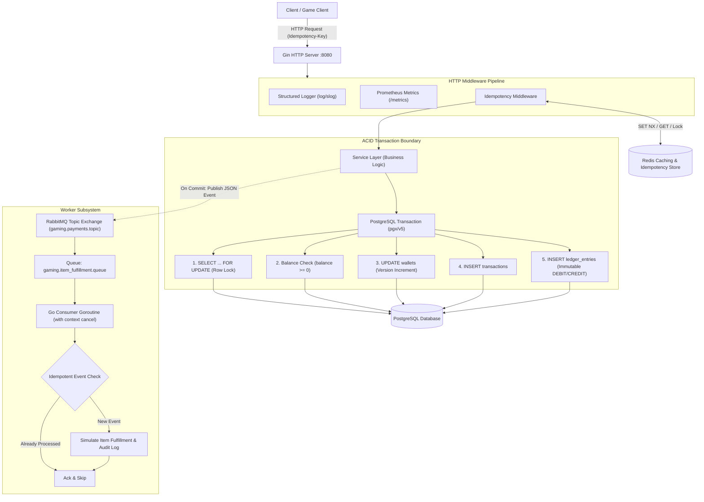
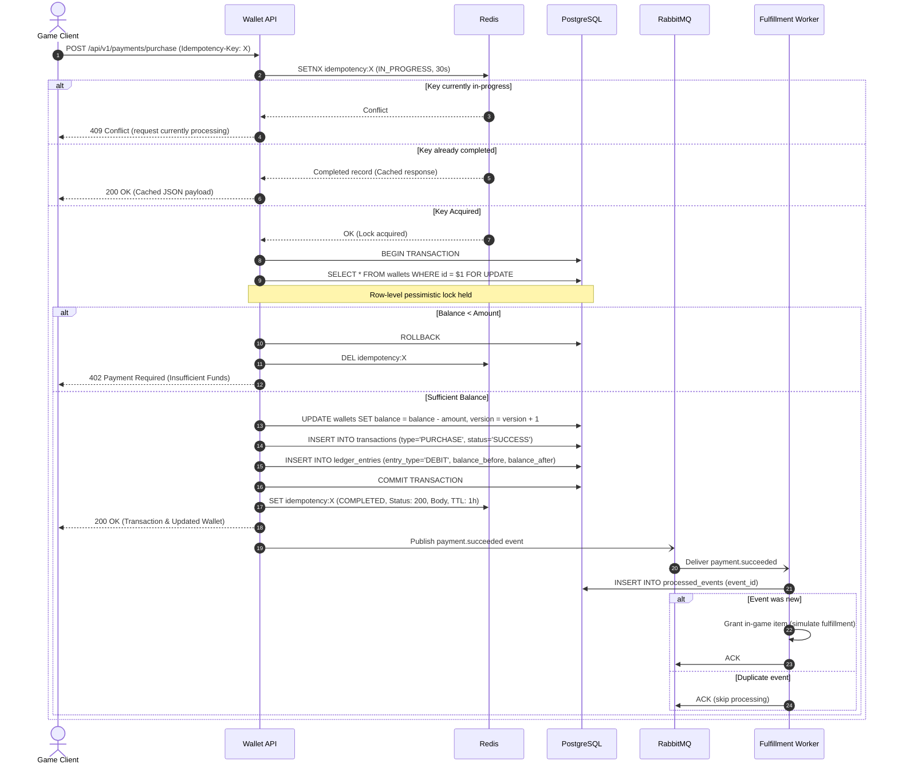

# Game Wallet & Payment Ledger Service (`game-wallet-ledger`)

A production-grade, high-throughput Go microservice designed for gaming monetization, player wallet balance management, in-game purchases, and automated refunds. Built following Clean Architecture principles, strict double-entry ledger bookkeeping, and idiomatic Go design standards.

---

## Architecture Overview



---

## Sequence Flow: In-Game Purchase & Fulfillment



---

## Key Design Decisions

### 1. Financial Invariants & Double-Entry Ledger
- **Integer Minor Units:** Balances and transaction amounts are stored as 64-bit integers (`BIGINT`) representing minor currency units (e.g. cents, $10.00 = `1000`, or discrete in-game gems/coins). This completely eliminates IEEE-754 floating-point rounding errors.
- **Immutable Ledger:** Every balance mutation (deposit, purchase, refund) creates an append-only row in `ledger_entries` containing `balance_before`, `balance_after`, `entry_type` (`DEBIT` or `CREDIT`), and `transaction_id`. Balance modifications can always be independently audited by summing ledger entries.
- **Multi-Level Constraint Enforcement:** Negative balances are prevented at both:
  1. The **Application layer** (`w.CanDebit(amount)` returning `domain.ErrInsufficientFunds`).
  2. The **Database layer** (`CHECK (balance >= 0)` constraint), guaranteeing zero overdrafts even under unexpected failures.

### 2. Concurrency Control & Zero Race Conditions
- **PostgreSQL Pessimistic Locking (`SELECT ... FOR UPDATE`):** When modifying a player's wallet, the service acquires an exclusive row-level database lock. Any concurrent purchase or deposit requests against the same wallet are serialized at the database engine level until the current transaction commits or rolls back.
- **Optimistic Version Verification:** Rows include a `version` column incremented on every write (`WHERE id = $1 AND version = $2`), ensuring double safety.

### 3. Distributed Idempotency Mechanism
- **Header:** All state-mutating endpoints require an `Idempotency-Key` header.
- **Request Fingerprinting:** The request body, method, and URL path are hashed using SHA-256 (`request_hash`). If an idempotency key is reused with mismatched parameters, the service responds with `422 Unprocessable Entity`.
- **Redis `SET NX`:**
  - If a key is currently executing, Redis returns an in-progress flag and the API immediately returns `409 Conflict`.
  - Once the transaction commits, the HTTP status code and response payload are saved to Redis with an expiration TTL (default: 60 minutes). Subsequent retries replay the cached response with zero database work.
  - If a transaction fails due to validation errors, the lock is released immediately so clients can retry.

### 4. Event-Driven Reliability (RabbitMQ)
- **Topic Exchange:** Completed purchases publish `payment.succeeded`, and refunds publish `payment.refunded` to a durable topic exchange (`gaming.payments.topic`).
- **At-Least-Once Delivery & Manual Acks:** Messages use persistent delivery mode. Consumers manually acknowledge (`d.Ack`) only after successful processing.
- **Idempotent Event Tracking:** The background fulfillment worker tracks processed event IDs in `processed_events`. Duplicate messages delivered by RabbitMQ are safely acknowledged and skipped without granting duplicate in-game items.

### 5. Production Observability & Graceful Shutdown
- **Prometheus Metrics (`/metrics`):**
  - `game_wallet_http_requests_total`: Counter partitioned by method, path, and HTTP status.
  - `game_wallet_http_request_duration_seconds`: Latency histogram for HTTP requests.
  - `game_wallet_ledger_transactions_total`: Counter partitioned by transaction type (`DEPOSIT`, `PURCHASE`, `REFUND`) and status (`SUCCESS`, `FAILED`).
  - `game_wallet_broker_events_processed_total`: Background worker event fulfillment counter.
- **Structured JSON Logging:** Native `log/slog` with request IDs, player IDs, and latency timings.
- **Graceful Shutdown:** Listens for `SIGINT` and `SIGTERM`. Closes HTTP listener, waits for in-flight requests, cancels the worker context, and safely drains PostgreSQL and Redis connection pools.

---

## Directory Structure

```text
game-wallet-ledger/
├── cmd/
│   └── api/
│       └── main.go                 # Application entrypoint & dependency injection
├── internal/
│   ├── config/                     # Environment variable parsing & defaults
│   ├── domain/                     # Entities: Wallet, Transaction, LedgerEntry, errors
│   ├── repository/
│   │   ├── postgres/               # pgx/v5 database pools, locking, migrations
│   │   └── redis/                  # Idempotency storage and lock management
│   ├── broker/
│   │   └── rabbitmq/               # RabbitMQ publisher & background fulfillment worker
│   ├── service/                    # Business logic (deposits, purchases, refunds)
│   └── handler/
│       └── http/                   # Gin handlers, middlewares (idempotency, logger, metrics)
├── migrations/
│   ├── 000001_init_schema.up.sql   # SQL table definitions and constraints
│   └── 000001_init_schema.down.sql # Rollback script
├── pkg/
│   ├── logger/                     # slog JSON logger with context correlation
│   ├── metrics/                    # Prometheus counter and histogram collectors
│   └── response/                   # Standardized JSON response formatting
├── scripts/
│   └── loadtest.go                 # High-throughput concurrency benchmark tool
├── Dockerfile                      # Multi-stage minimal Alpine production image
├── docker-compose.yml              # PostgreSQL, Redis, RabbitMQ, and API setup
├── Makefile                        # Automation recipes
├── go.mod
├── go.sum
└── README.md
```

---

## Getting Started

### Prerequisites
- [Docker](https://www.docker.com/) & Docker Compose
- [Go 1.23+](https://golang.org/dl/) (for local development and testing)

### Quick Start with Docker Compose

```bash
# 1. Start all infrastructure containers and API
make up

# 2. View running containers
make ps

# 3. Stream real-time logs
make logs
```

The service will be accessible at:
- **API Base URL:** `http://localhost:8080`
- **Health Check:** `http://localhost:8080/health`
- **Prometheus Metrics:** `http://localhost:8080/metrics`
- **RabbitMQ Management UI:** `http://localhost:15672` (Credentials: `guest` / `guest`)

---

## API Documentation & cURL Examples

### 1. Health Check
```bash
curl -i http://localhost:8080/health
```
```json
{
  "status": "UP",
  "timestamp": "2026-11-16T19:30:00Z",
  "checks": {
    "database": "UP",
    "rabbitmq": "UP",
    "redis": "UP"
  }
}
```

### 2. Create a Player Wallet
```bash
curl -i -X POST http://localhost:8080/api/v1/wallets \
  -H "Content-Type: application/json" \
  -d '{
    "player_id": "player_hero_99",
    "currency": "USD"
  }'
```
```json
{
  "success": true,
  "data": {
    "id": "c1f7b026-6a77-4b47-b86e-b3d9d5901594",
    "player_id": "player_hero_99",
    "currency": "USD",
    "balance": 0,
    "status": "ACTIVE",
    "version": 1,
    "created_at": "2026-11-16T19:30:05Z",
    "updated_at": "2026-11-16T19:30:05Z"
  },
  "timestamp": "2026-11-16T19:30:05Z"
}
```

### 3. Deposit Funds (Idempotent)
Deposit 5,000 cents ($50.00):
```bash
curl -i -X POST http://localhost:8080/api/v1/wallets/c1f7b026-6a77-4b47-b86e-b3d9d5901594/deposit \
  -H "Content-Type: application/json" \
  -H "Idempotency-Key: deposit-hero99-001" \
  -d '{
    "amount": 5000,
    "currency": "USD",
    "description": "Initial credit card top-up"
  }'
```
```json
{
  "success": true,
  "data": {
    "transaction": {
      "id": "e931448f-3dae-4f76-8f38-95ef61a5b8de",
      "wallet_id": "c1f7b026-6a77-4b47-b86e-b3d9d5901594",
      "player_id": "player_hero_99",
      "type": "DEPOSIT",
      "amount": 5000,
      "currency": "USD",
      "status": "SUCCESS",
      "description": "Initial credit card top-up"
    },
    "wallet": {
      "id": "c1f7b026-6a77-4b47-b86e-b3d9d5901594",
      "balance": 5000,
      "version": 2
    },
    "ledger_entry": {
      "id": "848bbce4-33eb-46bf-80a5-f7aa10db4e96",
      "entry_type": "CREDIT",
      "amount": 5000,
      "balance_before": 0,
      "balance_after": 5000
    }
  },
  "timestamp": "2026-11-16T19:30:10Z"
}
```

### 4. In-Game Purchase (Idempotent)
Purchase an in-game item for 1,500 cents ($15.00):
```bash
curl -i -X POST http://localhost:8080/api/v1/payments/purchase \
  -H "Content-Type: application/json" \
  -H "Idempotency-Key: purchase-hero99-chest-001" \
  -d '{
    "wallet_id": "c1f7b026-6a77-4b47-b86e-b3d9d5901594",
    "amount": 1500,
    "currency": "USD",
    "item_sku": "mythic_dragon_armor",
    "description": "Season 5 Mythic Armor bundle",
    "metadata": {
      "tier": "mythic",
      "game_server": "us-east-1"
    }
  }'
```
*(Notice: If you repeat this exact command with the same `Idempotency-Key`, the API replays the cached 200 response with header `X-Cache-Lookup: HIT-IDEMPOTENCY` without charging the wallet twice).*

### 5. Refund Transaction (Idempotent)
Refund the purchase transaction:
```bash
curl -i -X POST http://localhost:8080/api/v1/payments/refund \
  -H "Content-Type: application/json" \
  -H "Idempotency-Key: refund-hero99-001" \
  -d '{
    "original_transaction_id": "e931448f-3dae-4f76-8f38-95ef61a5b8de",
    "reason": "Player accidentally bought duplicate armor"
  }'
```

### 6. Inspect Immutable Ledger Audit Trail
```bash
curl -i "http://localhost:8080/api/v1/wallets/c1f7b026-6a77-4b47-b86e-b3d9d5901594/ledger?limit=10"
```

---

## Testing & Concurrency Verification

### Unit and Concurrency Test Suite
The service includes automated unit tests for domain business logic, HTTP middleware and handlers, as well as a 50-goroutine concurrent purchase simulation against a single wallet.

```bash
make test
```

Expected output:
```text
=== RUN   TestWallet_DomainRules
--- PASS: TestWallet_DomainRules (0.00s)
=== RUN   TestConcurrency_50ParallelPurchases
--- PASS: TestConcurrency_50ParallelPurchases (0.00s)
=== RUN   TestDeposit_Success
--- PASS: TestDeposit_Success (0.00s)
=== RUN   TestHandler_CreateWallet
--- PASS: TestHandler_CreateWallet (0.00s)
=== RUN   TestHandler_HealthCheck
--- PASS: TestHandler_HealthCheck (0.00s)
PASS
ok      game-wallet-ledger/internal/service     0.35s
ok      game-wallet-ledger/internal/handler/http 0.38s
```

### High-Throughput Load Testing Benchmark
Run the bundled benchmarking utility against the live service:

```bash
make load-test
```

This script:
1. Verifies service health.
2. Creates an isolated benchmark wallet and deposits 10,000,000 units.
3. Fires 500 concurrent purchase requests across 25 parallel worker goroutines with unique idempotency keys.
4. Generates an analysis report measuring throughput (RPS) and latency distribution (P50, P95, P99).

---

## Makefile Command Reference

| Command | Description |
| :--- | :--- |
| `make up` | Starts all dependencies and service using Docker Compose |
| `make down` | Gracefully shuts down and cleans up containers and volumes |
| `make restart` | Recreates containers from scratch |
| `make logs` | Tails live aggregated container logs |
| `make test` | Executes the unit and 50-parallel concurrency test suite |
| `make build` | Compiles the native Go binary locally |
| `make migrate-up` | Applies SQL migrations to the PostgreSQL container |
| `make migrate-down` | Rolls back database migrations |
| `make load-test` | Runs the high-concurrency throughput and latency benchmark |
