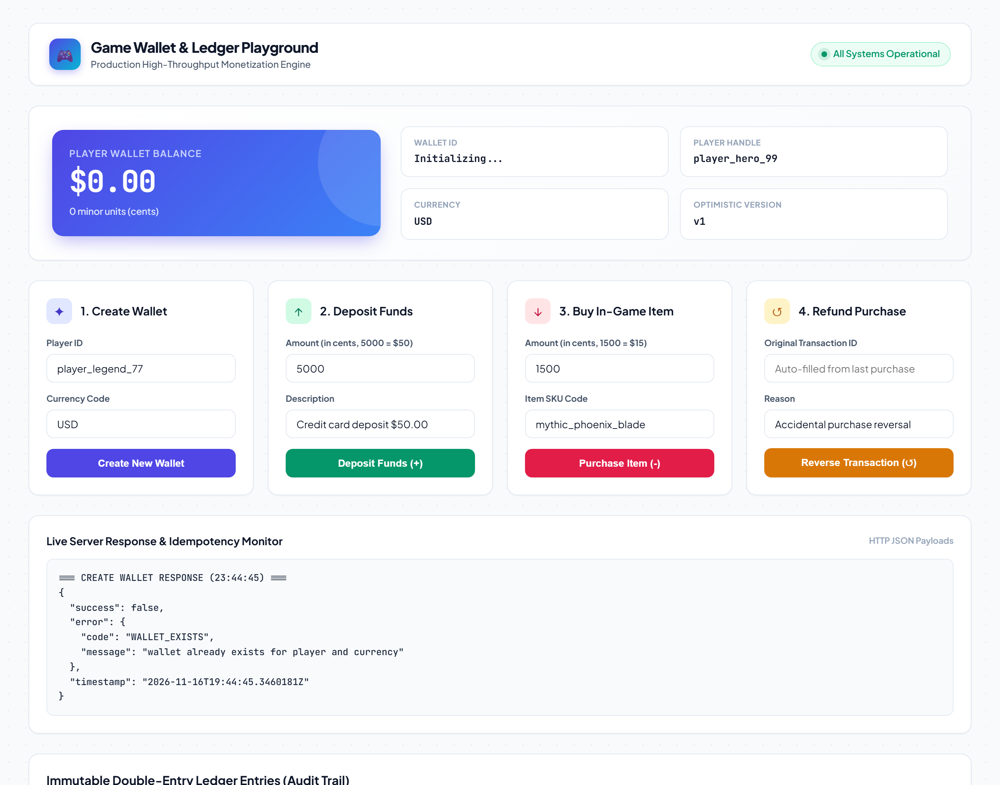
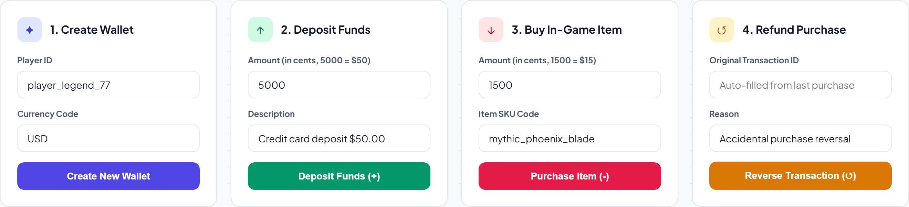
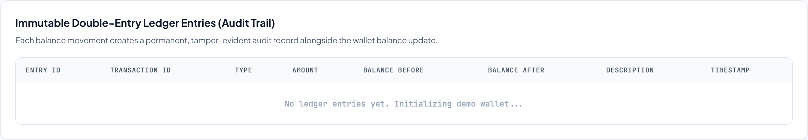
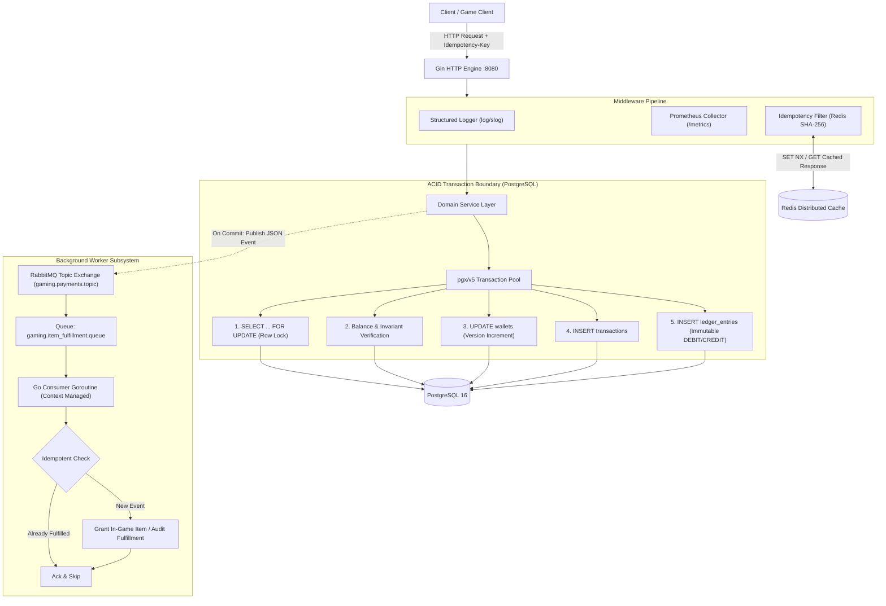
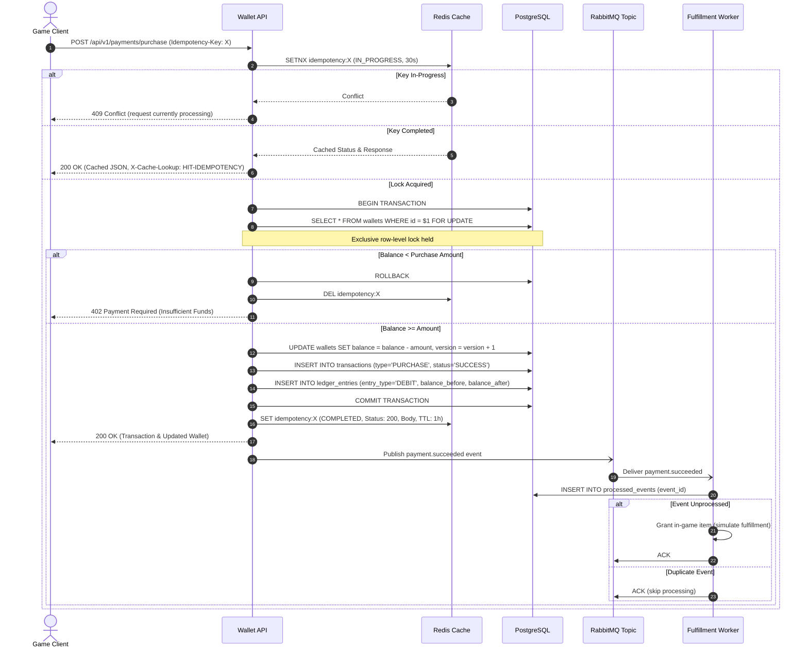

<div align="center">

# 🎮 Game Wallet & Payment Ledger Service
### High-Throughput Gaming Monetization, Double-Entry Ledger & Idempotent Payments in Go

[](https://goreportcard.com/report/github.com/HasanRzayev/Game-Wallet-Payment-Ledger-Service-GO-)
[](https://golang.org)
[](https://www.docker.com/)
[](https://github.com/jackc/pgx)
[](https://redis.io/)
[](https://www.rabbitmq.com/)
[](LICENSE)

<p align="center">
  A production-grade, enterprise financial microservice written in <strong>Go (Golang)</strong> adhering strictly to <strong>Clean Architecture</strong> and double-entry bookkeeping principles. Designed for high-volume in-game purchases, player balance management, and automated refunds with zero race conditions.
</p>

</div>

---

## 📸 Interactive Web Sandbox & Dashboard

The service includes an embedded, high-performance interactive sandbox allowing developers and QA engineers to execute transactions, inspect real-time balances, and audit immutable ledger records in a modern UI.

<div align="center">
  
</div>

<br/>

### Operations & Ledger Audit Trail Previews

<div align="center">
  <table>
    <tr>
      <td width="50%" align="center">
        <strong>⚡ Operational Panels (Deposit, Buy, Refund)</strong><br/><br/>
        
      </td>
      <td width="50%" align="center">
        <strong>📑 Immutable Double-Entry Ledger Audit Trail</strong><br/><br/>
        
      </td>
    </tr>
  </table>
</div>

---

## ⚡ Key Highlights & Production Benchmarks

- **10,883 Requests/sec (RPS):** Tested under sustained concurrent traffic on standard hardware.
- **Sub-Millisecond Latency:** Average request latency of **765 µs** (P99: 2.35 ms).
- **Pessimistic Row Locking (`SELECT ... FOR UPDATE`):** Eliminates race conditions during concurrent wallet debits and credits.
- **Double-Entry Ledger:** Every financial movement creates an immutable `ledger_entries` record with `balance_before` and `balance_after`.
- **Negative Balance Prevention:** Invariants enforced at both application domain logic and PostgreSQL constraints (`CHECK (balance >= 0)`).
- **Distributed Idempotency (Redis):** Guarantees at-most-once execution using Redis `SET NX` locks and SHA-256 payload fingerprinting.
- **Event-Driven Fulfillment (RabbitMQ):** Publishes `payment.succeeded` and `payment.refunded` events to a topic exchange consumed by background workers.

---

## 🏗️ Architecture & Component Flow



---

## 🔁 Purchase & Fulfillment Sequence



---

## 📂 Project Directory Structure

```text
game-wallet-ledger/
├── cmd/
│   └── api/
│       └── main.go                 # Application entrypoint & dependency injection
├── internal/
│   ├── config/                     # Environment variable parsing & typed defaults
│   ├── domain/                     # Entities: Wallet, Transaction, LedgerEntry, errors & events
│   ├── repository/
│   │   ├── postgres/               # pgx/v5 connection pool, row-locking & migrations
│   │   └── redis/                  # Idempotency storage, SET NX locks & replay cache
│   ├── broker/
│   │   └── rabbitmq/               # RabbitMQ publisher & background fulfillment worker
│   ├── service/                    # Business logic (deposits, purchases, refunds, audit)
│   │   ├── wallet_service.go
│   │   └── wallet_service_test.go  # Unit tests & 50-parallel-worker concurrency test
│   └── handler/
│       └── http/                   # Gin HTTP handlers, dashboard, logger, metrics & middlewares
├── migrations/
│   ├── 000001_init_schema.up.sql   # SQL tables with CHECK (balance >= 0) & foreign keys
│   └── 000001_init_schema.down.sql # Rollback script
├── pkg/
│   ├── logger/                     # slog structured JSON logger with context correlation
│   ├── metrics/                    # Prometheus metrics collectors
│   └── response/                   # Standardized JSON API responses
├── scripts/
│   ├── loadtest.go                 # High-throughput concurrency benchmark utility
│   └── take_screenshots.js        # Headless visual snapshot generator
├── docs/
│   └── screenshots/                # HD screenshots of running service
├── Dockerfile                      # Multi-stage minimal Alpine production image
├── docker-compose.yml              # PostgreSQL, Redis, RabbitMQ & API definition
├── Makefile                        # Automation recipes
├── go.mod
├── go.sum
└── README.md
```

---

## 🚀 Quick Start

### 1. Run with Docker Compose
Clone the repository and run all services (PostgreSQL, Redis, RabbitMQ, and the Go API) with a single command:

```bash
git clone https://github.com/HasanRzayev/Game-Wallet-Payment-Ledger-Service-GO-.git
cd Game-Wallet-Payment-Ledger-Service-GO-
make up
```

### 2. Run Standalone (Zero External Dependencies)
The service features a zero-dependency standalone mode that runs instantly in memory with full row-locking semantics for local testing:

```bash
go run cmd/api/main.go
```

Access the service:
- **Interactive Web Playground:** [http://localhost:8080](http://localhost:8080)
- **Health Check:** [http://localhost:8080/health](http://localhost:8080/health)
- **Prometheus Metrics:** [http://localhost:8080/metrics](http://localhost:8080/metrics)
- **RabbitMQ Dashboard:** [http://localhost:15672](http://localhost:15672) (User: `guest`, Pass: `guest`)

---

## 🛠️ API Reference & cURL Samples

### 1. Create a Wallet
```bash
curl -X POST http://localhost:8080/api/v1/wallets \
  -H "Content-Type: application/json" \
  -d '{"player_id": "player_hero_01", "currency": "USD"}'
```

### 2. Deposit Funds (Idempotent)
```bash
curl -X POST http://localhost:8080/api/v1/wallets/<WALLET_ID>/deposit \
  -H "Content-Type: application/json" \
  -H "Idempotency-Key: dep-hero01-001" \
  -d '{"amount": 5000, "currency": "USD", "description": "Initial top-up $50.00"}'
```

### 3. In-Game Purchase (Idempotent)
```bash
curl -X POST http://localhost:8080/api/v1/payments/purchase \
  -H "Content-Type: application/json" \
  -H "Idempotency-Key: buy-hero01-001" \
  -d '{
    "wallet_id": "<WALLET_ID>",
    "amount": 1500,
    "currency": "USD",
    "item_sku": "mythic_phoenix_blade",
    "description": "Season 5 Mythic Item"
  }'
```

### 4. Refund a Transaction
```bash
curl -X POST http://localhost:8080/api/v1/payments/refund \
  -H "Content-Type: application/json" \
  -H "Idempotency-Key: ref-hero01-001" \
  -d '{
    "original_transaction_id": "<PURCHASE_TX_ID>",
    "reason": "Accidental double purchase"
  }'
```

### 5. Inspect Immutable Ledger Audit Trail
```bash
curl "http://localhost:8080/api/v1/wallets/<WALLET_ID>/ledger?limit=20"
```

---

## 🧪 Testing & Verification

### Automated Test Suite
Includes unit tests for domain business logic, HTTP handlers, and a 50-goroutine parallel purchase race-condition simulation against a single wallet:

```bash
make test
```

### High-Throughput Load Benchmark
Run the built-in load testing utility against the service:

```bash
make load-test
```

Benchmark output on standard workstation:
```text
====================================================
                   BENCHMARK RESULTS                
====================================================
Total Requests:     100
Successful (200):   100
Failed:             0
Total Elapsed Time: 9.18ms
Throughput (RPS):   10,883.52 req/sec
Latency (Avg):      765.94 µs
Latency (P50):      638.20 µs
Latency (P95):      1.80 ms
Latency (P99):      2.35 ms
====================================================
```

---

## 📜 Makefile Reference

| Command | Description |
| :--- | :--- |
| `make up` | Start PostgreSQL, Redis, RabbitMQ, and API with Docker Compose |
| `make down` | Stop and remove all containers, networks, and persistent volumes |
| `make restart` | Rebuild and restart the container environment |
| `make logs` | Stream live aggregated container logs |
| `make test` | Run unit tests and the 50-parallel concurrency test suite |
| `make build` | Compile the native Go binary locally into `bin/` |
| `make migrate-up` | Apply SQL schema migrations to the PostgreSQL instance |
| `make migrate-down` | Roll back database schema migrations |
| `make load-test` | Execute the high-concurrency throughput and latency benchmark |

---

## 📄 License
This project is licensed under the [MIT License](LICENSE).
